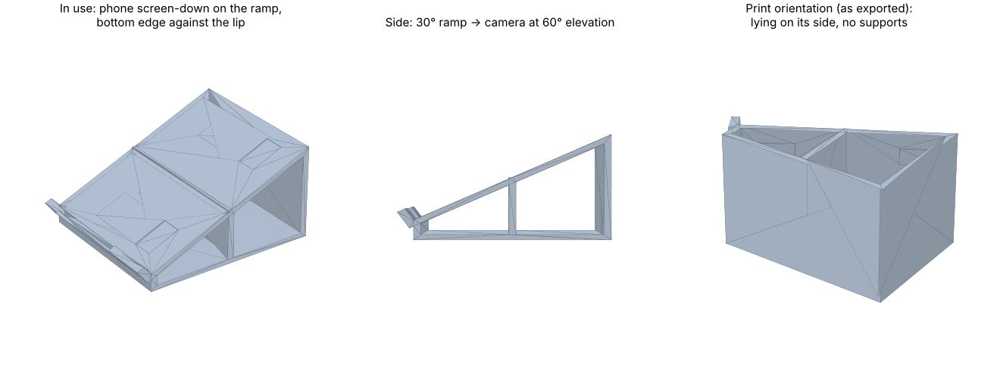

# StarLocator

[](https://github.com/theJaraxleNUKE/StarLocator/actions/workflows/build-apk.yml)
[](https://github.com/theJaraxleNUKE/StarLocator/releases/latest)
[](LICENSE)

An Android app that works out **where on Earth you are from a photo of the night sky**. It uses only the phone's camera, its accelerometer and its clock: no GPS, no Wi-Fi, no cell towers, no Internet.

**Permissions:**
- `CAMERA` photographs the stars.
- Location is asked for **only** if you choose **USE GPS** for the optional one-time calibration. It is never used to compute a fix, and you can type the coordinates instead.
- There is **no Internet permission**. Every CI build fails if a network permission is added.

Written in C# for .NET 10 for Android. The star-identification core is a platform-independent .NET library.

> **Status:** star identification works on real photos (two field tests, 36 frames). **Position accuracy on a real phone is not yet good.** The second field test found that the phone's camera image shifted up to ~1° inside the phone between frames, which no calibration can remove (see [Field test 2](#field-test-2-real-phone-second-night-november-2026)). Version 1.0.7 switches optical image stabilisation off and detects this problem; it has not yet been field-tested.

---

## Contents

- [Download & install](#download--install)
- [Using the app](#using-the-app)
- [How it works](#how-it-works)
- [Accuracy](#accuracy)
- [Limitations](#limitations)
- [3D-printed 60° mount](#3d-printed-60-mount)
- [Building from source](#building-from-source)
- [CI and releases](#ci-and-releases)
- [Project layout](#project-layout)
- [Credits](#credits)

---

## Download & install

1. Open [**Releases**](https://github.com/theJaraxleNUKE/StarLocator/releases/latest) on the phone and download `StarLocator-<version>.apk`.
2. Open the file. When Android asks, allow **"Install unknown apps"** for your browser or file manager.
3. Requirements:
   - Android 8.0 (API 26) or newer, on a 64-bit ARM phone (or an x64 emulator).
   - A back camera that supports **manual exposure** (Camera2 `MANUAL_SENSOR`). The app tells you if yours doesn't.

Each release also has a `.sha256` file for checking the download.

## Using the app

The main screen has one big round button, the result, a calibration badge, and two buttons at the top: **History** and **Advanced**. There is no camera preview: in the mount the screen faces down, so the app signals with beeps instead.

1. **Go outside on a clear night.** Avoid the Moon and bright lights.
2. Tap **Locate**. During the countdown (10 s by default) the app beeps once a second. Put the phone **screen-down** in the [60° mount](#3d-printed-60-mount), or on a rock or car roof, so the back camera points **45–90° up** at clear sky.
3. A higher tone means capturing has started: don't touch the phone. A long tone means it's done and you can pick the phone up. The ring shows progress (countdown, frame 1/4…, identifying stars). Tap it to cancel.
4. The card shows the fix in degrees-minutes-seconds and decimal degrees, an estimated 1-σ error in km, and how many frames were used. **Open map** passes the fix to any installed map app as a `geo:` link (offline map apps work). **Copy** copies the decimal coordinates. Warnings show under the fix, e.g. "not calibrated", "phone was 4° off the calibration pose" or "camera image shifted 0.3° inside the phone" (see [image stability](#image-stability)).

By default the app takes 4 frames at ¼×, ½×, 1× and 2× the set exposure (4 s at ISO 1600 → 1, 2, 4 and 8 s, clamped to what the camera supports). Each frame is solved on its own. Failed frames are skipped, outliers (for example a frame where the phone was bumped) are rejected, and the rest are combined into one fix.

### History

**History** lists every fix the app has produced, newest first: date and time, coordinates, the ± error, how many frames were used, and whether it was calibrated or had warnings. Tap an entry to open it in your map app; touch and hold to delete it; **Clear** removes them all. The list is kept in the app's private storage on the phone (up to 1,000 fixes) and is never sent anywhere.

### Advanced

| Section | What's there |
|---|---|
| **Last capture** | Per-frame report (stars detected and identified, fit, motion warnings), the combined result with its random/systematic error split, and the frame with the most identified stars: identified stars circled in green and named, unmatched detections circled in red. |
| **Capture** | Camera (when the phone exposes more than one back camera, labelled by 35 mm-equivalent focal length, with whether it has optical stabilisation), countdown (Off / 5 s / 10 s), exposure, ISO, exposure bracket on/off. |
| **Calibration** | Status, the known-location field, **Use GPS**, **Calibrate**, **Forget calibration**. |
| **Files** | **Save last capture (.zip)**: frames, camera/accelerometer data and the report as one zip, saved wherever you choose. The capture folder also holds `report.txt`, so a zip of the folder made with a file manager is complete too. The zip protects the binary frames, which some apps corrupt when sent as raw `.pgm`. **Keep every captured frame** also stores all frames under `Android/data/io.github.thejaraxlenuke.starlocator/files/frames/`, with save-as-zip and delete buttons. |
| **Display** | Red night-vision colours. |
| **Device** | Live camera elevation and calibration-pose check, UTC time, camera capabilities, and the learned lens correction (with reset). |

### One-time calibration (do this once)

Uncalibrated fixes are typically **tens of km** off. In the field test that was 21 km, from a 0.19° error in the phone's "straight up" reading (accelerometer offset plus how the camera module sits). Calibration removes that error:

1. Go to a spot whose position you know. Put the phone in the **mount** (or whatever fixed support you'll always use).
2. Tap the **Not calibrated** badge (or Advanced › Calibration) and fill in the position:
   - **Use GPS**: one GPS reading, accepted at ≤ 20 m accuracy, used for nothing else. It also reports how far the phone clock is off GPS time.
   - Or type it, e.g. `40.68925, -74.0445` or `40°41'21.3"N 74°02'40.2"W`.
3. Tap **Calibrate**. A normal countdown and bracket follow. The app reports how far off the uncalibrated result was, then saves the correction for this camera.
4. From then on, use the **same mount, seating and case**. A fix shows a warning when the pose differed from the calibration pose by more than 3°, or the phone's temperature by 10 °C or more. Advanced › Device shows the pose check live.

Calibrations made with versions before 1.0.7 are not used any more: 1.0.7 switches optical stabilisation off, which moves the image centre, so calibrate once more.

The app **refuses a calibration** whose frames disagree with each other by more than 0.1° (≈11 km) after dropping single bad frames, and says why. Such frames mean the camera image is not fixed to the phone body, so there is no constant error to store.

If the calibration frames come from clearly different tilts (≥ 15° apart), the app instead solves the accelerometer bias and camera misalignment separately, and the calibration then works in any pose. In a fixed mount, the pose-specific correction is the simpler and exact one.

If too few stars are found, increase the exposure or ISO in Advanced › Capture, or find a darker spot.

## How it works

A phone can act like a sailor's sextant:

| Navigation tool | Phone part | What it gives |
|---|---|---|
| Sextant | Camera + star identification | Which way the phone points relative to the stars |
| Artificial horizon | Accelerometer | Which way is "straight up" in the phone's frame |
| Chronometer | Clock | How far the Earth has rotated |

The star tracker comes from **Marbel, Ben-Moshe & Yozevitch, "Star-Tracker Algorithm for Smartphones and Commercial Micro-Drones", *Sensors* 20(4):1106, 2020** ([open access](https://pmc.ncbi.nlm.nih.gov/articles/PMC7070887/)). The paper gives the camera's **orientation** only. StarLocator adds the gravity vector and the clock to turn that into a **position**.

### Pipeline

| # | Step | File |
|---|---|---|
| 1 | **Star detection.** Per-block background and robust noise estimate, threshold, 8-connected components, background-subtracted sub-pixel centroids. Blobs that are too small (hot pixels), too large (Moon, lamps) or elongated more than 3.5 : 1 (lit branches, wires, aircraft trails) are rejected. | `StarDetector.cs` |
| 2 | **Star Pattern Hash Table** (paper §3.1). Every triplet of catalog stars brighter than magnitude 4.0 whose sides are 1–30° is keyed by its three sorted, quantised angular distances. That is 518 stars and 94,439 triangles, built at start-up in about 0.05 s on a desktop CPU. | `StarPatternHash.cs` |
| 3 | **Matching + confidence voting** (paper §3.2). Triangles from the 24 brightest detections are looked up with a ±0.4° tolerance. Each catalog match votes for a star label, weighted by 1/(number of matches), so ambiguous triangles count less. | `StarIdentifier.cs` |
| 4 | **Validation** (paper §3.3). Pairs of voted labels give exact orientation hypotheses (TRIAD). A hypothesis is accepted only if **at least 4 independently voted labels agree** with it, the matched-star count beats chance by more than 5σ, and the fit RMS is under half the match tolerance (chance matches spread over the whole tolerance disc). A solution found by the wide focal-length sweep must match twice as many stars. | `StarIdentifier.cs` |
| 5 | **Refinement + lens self-calibration.** Least-squares orientation (Davenport q-method) over all matched stars down to magnitude 5.5. The focal length and radial distortion K1 are refined from the stars. If the phone's reported focal length doesn't work, scales 0.90–1.10 are tried, then **0.6–1.6 in 2% steps**: the first real phone tested reported a focal length 26% too short. The app **saves the learned correction per camera**. | `StarIdentifier.cs`, `Attitude.cs` |
| 6 | **Gravity → zenith.** The accelerometer is averaged over exactly the exposure window to give "up" in the phone frame. Atmospheric refraction is removed per star (Bennett). The solved orientation maps "up" onto the sky. | `PositionSolver.cs`, `Astronomy.cs` |
| 7 | **Zenith → latitude/longitude.** The zenith is precessed from J2000 to the date (IAU 1976) and rotated by Greenwich Mean Sidereal Time. **Latitude = declination of the zenith; longitude = its right ascension − GMST.** | `Astronomy.cs` |
| 8 | **Exposure bracket.** Each frame of a capture is solved on its own. Fixes are checked against a robust centre (geometric median); frames more than 3× the robust spread away are rejected; the rest are averaged with 1/σ² weights. Only the random error shrinks with more frames. The systematic part (shared tilt error) is carried through unchanged, so the ± figure stays honest. | `PositionSolver.CombineFixes` |
| 9 | **One-time calibration at a known position.** With the true zenith known, each frame measures the "up" error directly: `r = a − g·M·z`. Frames over 5° off and frames far from the median are dropped; if the rest still disagree by more than 0.1° the calibration is refused. From one pose, the mean `r` is stored as a pose-specific correction. From several tilts, `a = g·M·z + [M·z ×]·w′ + b` is solved linearly for local gravity `g`, accelerometer bias `b` and camera misalignment `w` (7 unknowns). | `PositionSolver.CalibrateAtKnownLocation` |
| 10 | **Image-stability check.** Each frame's zenith direction `Mᵀ·a` stays put when the whole phone moves (camera and accelerometer move together), but shifts if the image moves *inside* the phone. The spread across a capture's frames is reported, and a fix is flagged unreliable above 0.05°. | `PositionSolver.ZenithSpread` |
| 11 | **Reference-free calibration** (library only). If no known position is available, a Gauss-Newton fit over 4+ tilted shots solves for position, bias and misalignment together. | `PositionSolver.SolveMulti` |

Camera intrinsics come from Android's factory `LENS_INTRINSIC_CALIBRATION` when the phone provides it. Otherwise they come from focal length ÷ sensor size. Lens distortion is corrected by the camera itself where supported, and otherwise from `LENS_DISTORTION`. Exposure uses Camera2 manual mode with focus at infinity, reading the raw luminance (Y) plane. Optical image stabilisation, video stabilisation, noise reduction and edge enhancement are switched **off** (where the camera allows), and every frame's sidecar file records what the camera actually applied: OIS mode, the OIS lens-shift samples (Android 12+), the active physical lens of a multi-camera, focal length and focus distance.

[`docs/paper-review.md`](docs/paper-review.md) compares the implementation with the paper section by section.

The star catalog is the **Yale Bright Star Catalog, 5th ed.** (9,096 stars, J2000), embedded in the core library.

## Accuracy

### Field test (real phone, one night, November 2026)

One 4-frame bracket (1/2/4/8 s, ISO 2000, camera at 53° elevation, Moon 75% lit), compared with the true position.

| | Result |
|---|---|
| With the phone's reported focal length | **all 4 frames failed**: the phone reports a focal length 26% too short |
| With the focal length learned from the stars (×1.259, same in all frames to 0.1%) | **all 4 frames solved**, 76–79 stars each, fit RMS **0.036–0.044°** |
| Uncalibrated position error (1 / 2 / 4 s frames) | **21.4 / 20.8 / 20.9 km**; 8 s frame 29.6 km, rejected as an outlier by the combiner |
| Cause of the remaining error | 0.19° error in the phone's "up" reading, the same in every frame |
| Calibrate on two frames, test on the third (same session) | **0.6–1.4 km** |

The real star fit (≈0.04°) is better than the paper's 0.1–0.3°. The same-session calibration test checks the method but **not** how long a calibration stays valid; that needs captures on different nights.

### Field test 2 (real phone, second night, November 2026)

Same phone and place, version 1.0.6, phone in the 60° mount on a clear night: 8 captures, 32 frames (1–16 s, ISO 1600–2400).

| | Result |
|---|---|
| Star identification | **32 of 32 frames solved**, 61–80 stars each, fit RMS 0.04–0.06° |
| Accelerometer | steady to < 0.01° within every capture; elevation 60.1–61.1° |
| Uncalibrated error per capture | **17–204 km** (very different from capture to capture) |
| Calibrate on one capture, test on another | **5–280 km**; on the same capture 1–3 km |
| Camera image vs phone body | **the image moved inside the phone**: up to 0.65° of tilt within a 22 s capture while the accelerometer moved < 0.01°; Polaris shifted 56 px (0.94°). When the phone really moved (bumped, or turned 25° in the mount) camera and accelerometer agreed |

Diagnosis: the "up" error was not a fixed property of the phone but changed from capture to capture (0.17–1.8°) and drifted with exposure length. This matches the camera's optical image stabilisation, which the Camera2 still-capture template leaves on and 1.0.6 did not switch off. It may also be another kind of image stabilisation or processing on that phone. 1.0.7 switches all stabilisation off, logs the lens-shift data where Android provides it, warns about unsteady captures, refuses unsteady calibrations and lets you choose another back camera (ultra-wide lenses usually have no OIS). Field test 3 confirmed the cure.

### Field test 3 (same phone, home driveway, version 1.0.8)

Phone in the 60° mount on a slightly sloping driveway (camera at 57.4–57.8°), stabilisation off, GPS calibration on the spot. 4 captures, 16 frames, trees in the lower part of the view.

| | Result |
|---|---|
| Stabilisation | off in every frame; reported OIS lens shift < 1 px |
| Image steadiness within a capture | 0.02–0.055° (field test 2: up to 0.65°). The remaining 0.04–0.05° is a repeatable jump of ~4 px after the second frame of every bracket |
| Calibrate on one good capture, test on another (the 3 good captures) | **0.9–4 km** |
| App fix right after calibrating (22:48) | **1.3 km** from the GPS calibration point |
| Fix made with an earlier calibration (22:46) | 15.5 km off: that calibration's frames were not kept, so the cause can't be traced |
| Last capture (22:49) | 3 of 4 frames rejected because lit tree branches crowded out the stars; fixed in 1.0.9 (elongated blobs are now ignored: all 4 frames solve). Its lens focal-length scale had also changed by 0.7%, and its fix was 7–10 km from the others |

So with stabilisation off, the method reaches **a few km** on this phone, as long as the lens is in the same state as during calibration. 1.0.9 records the lens scale with the calibration and warns when a capture's lens scale differs by more than 0.3%, or when the exposure/ISO/bracket differ from the calibration capture.

### Simulator

All figures below come from the test suite in `tests/StarLocator.Tests`. It renders 4000×3000 sky images for known places and times, including sensor noise, a light-pollution gradient, cloud, fake planes/planets, ±5% focal-length error, lens distortion and star-position jitter.

**Star matching only (perfect accelerometer), 40 random frames per row:**

| Per-star position noise | Frames solved | Wrong fixes | Median error | 90th percentile |
|---|---|---|---|---|
| 0 px (0.00°) | 37 / 40 | 0 | 1.6 km | 2.9 km |
| 3 px (0.06°) | 39 / 40 | 0 | 2.0 km | 3.9 km |
| 6 px (0.11°) | 38 / 40 | 0 | 3.5 km | 5.8 km |
| 10 px (0.19°) | 36 / 40 | 0 | 5.7 km | 12.2 km |

Pure noise fields with random blobs gave **0 false fixes in 30 trials**, including with the wide focal-length search enabled.

**Exposure bracket at one pose** (frames reaching magnitude 3.5 / 4.0 / 4.5 / 5.0, 6 px star noise), plus a fifth frame where the phone was bumped:

| Frame | Result |
|---|---|
| 1 s (mag 3.5) | not solved: too few stars (the bracket covers for this) |
| 2 s / 4 s / 8 s | 2.3 / 2.5 / 2.9 km error |
| bumped frame | 270 km error, **rejected automatically** |
| **Combined** | **1.1 km** |

**With realistic phone errors** (accelerometer bias 0.15 m/s² ≈ 0.9°, camera mounting error 0.4°, principal point off by 20 px):

| Mode | Error |
|---|---|
| Single shots, uncalibrated | 24–55 km |
| **One-time calibration in a fixed 60° pose**, then captures at other places, nights and compass directions | **2.1–4.7 km** (uncalibrated 29–30 km) |
| Same, but the phone 5° away from the calibration pose | 5.9 km |
| Known-position calibration from 3 different tilts, then any pose | 1.8–4.1 km |
| Reference-free 6-shot calibration | 0.8 km; later single shots 0.5–3.9 km |

Rules of thumb:

- 1° of tilt error ≈ **111 km**. The accelerometer is usually the biggest error source, so calibrate.
- 1 s of clock error ≈ **0.46 km** of longitude at the equator. Without network time the phone clock can drift.
- The ± figure the app shows is a model-based estimate, not a guarantee.

## Limitations

<a id="image-stability"></a>
- Phone camera lenses are not perfectly repeatable: a small change in the lens position shows up as a change in focal-length scale together with a shift of the image, worth several km. The app warns when the lens scale differs from the calibration capture.
- **The camera image must be rigidly fixed to the phone body**, to about 0.01°. Optical image stabilisation, sensor-shift stabilisation or image warping in the camera software break this: 0.1° of image shift is ≈11 km of error. The app switches what it can off and warns when frames disagree, but some phones may not let apps turn stabilisation off.
- Works at night only, and needs about 6+ identifiable stars: clear sky, nothing blocking the view.
- Needs manual exposure (`MANUAL_SENSOR`) on the back camera.
- Effects ignored because they are far below the sensor limits: nutation (≈17″), annual aberration (≈20″), UT1−UTC (<0.9 s), polar motion, star proper motion and deflection of the vertical.
- Planets are not in the catalog. They are treated as outliers and ignored.

## 3D-printed 60° mount

[`hardware/mount/`](hardware/mount/) has a printable ramp that holds the phone screen-down at 30°, so the camera points 60° up, the **same way every time**. That repeatability is what keeps a one-time calibration valid. The STL is also attached to every release.



- 113 × 100 × 80 mm; a lip with a speaker/USB slot; recesses for felt pads to protect the screen.
- Prints on its side without supports.
- Parametric OpenSCAD source, so you can change the angle or size.

See [hardware/mount/README.md](hardware/mount/README.md) for print and usage notes.

## Building from source

Requirements: [.NET 10 SDK](https://dotnet.microsoft.com/download), the Android workload, and JDK 17 (the CI uses Temurin 17).

```bash
dotnet workload install android

# Solver tests: no phone or Android SDK needed
dotnet run --project tests/StarLocator.Tests -c Release            # unit + end-to-end tests
dotnet run --project tests/StarLocator.Tests -c Release -- sweep   # 160-frame robustness sweep
dotnet run --project tests/StarLocator.Tests -c Release -- replay path/to/frame_YYYYMMDD_HHMMSS.pgm

# Android SDK packages the app needs (once), then build / install
dotnet build src/StarLocator.Android -t:InstallAndroidDependencies -f net10.0-android \
  -p:AndroidSdkDirectory=<path-to-android-sdk> -p:AcceptAndroidSDKLicenses=True
dotnet publish src/StarLocator.Android -c Release -f net10.0-android     # -> *-Signed.apk
dotnet build   src/StarLocator.Android -c Release -t:Install              # to a USB-connected phone
```

You can also open `StarLocator.sln` in an IDE that supports .NET 10 Android projects and run it on a device.

## CI and releases

`.github/workflows/build-apk.yml` runs on GitHub's `ubuntu-latest` runner.

| Trigger | What happens |
|---|---|
| **Push to `main`** (or a manual run on `main`) | Runs the solver tests, builds the APK, checks its signature, package and permissions (fails on any network permission), uploads it as a workflow artifact, and **publishes a GitHub Release `v1.0.<run number>`** with `StarLocator-<version>.apk`, its `.sha256` and the mount STL |
| Push a tag `v*` (e.g. `v1.1.0`) | The same, but the release uses that exact version |
| Pull request | Tests and build only, no release |

So every change merged to `main` automatically produces a new downloadable APK under [Releases](https://github.com/theJaraxleNUKE/StarLocator/releases). The `versionCode` is the workflow run number, so it always increases. To change the `1.0` prefix, edit `VERSION_PREFIX` in the workflow.

### Signing key (recommended)

Android only installs an update over an existing copy if both are signed with the **same key**. Without a key of your own, each CI run signs with a fresh throwaway debug key, and you would have to uninstall before installing a newer build. To sign every build with one permanent key:

```bash
keytool -genkeypair -keystore starlocator-release.keystore -storetype PKCS12 \
        -alias starlocator -keyalg RSA -keysize 4096 -validity 10000
# use the same password for the keystore and the key
base64 -w0 starlocator-release.keystore     # macOS: base64 -i starlocator-release.keystore
```

Then, under **Settings → Secrets and variables → Actions → New repository secret**, add:

| Secret | Value |
|---|---|
| `ANDROID_KEYSTORE_BASE64` | the base64 output above |
| `ANDROID_SIGNING_PASSWORD` | the keystore/key password |

The key alias must be `starlocator`. Back up the keystore file and password somewhere safe: GitHub secrets can't be read back.

## Project layout

```
src/StarLocator.Core/       Solver library (net10.0): detection, hash table, identification,
                            attitude, astronomy, position + calibration; embedded BSC5 catalog
src/StarLocator.Android/    Android app (net10.0-android): Camera2 manual capture, accelerometer
                            sampling, UI, result rendering, calibration storage, frame export
tests/StarLocator.Tests/    Sky simulator, unit + end-to-end tests, robustness sweep, frame replay
hardware/mount/             3D-printable 60° phone mount (OpenSCAD source, STL, preview)
art/icon/                   App icon source (SVG); the app uses it as an adaptive vector icon
docs/paper-review.md        Section-by-section comparison with the Marbel et al. (2020) paper
.github/workflows/          CI: test, build, verify and release the APK
```

## Credits

- Star-tracker algorithm: Marbel, Ben-Moshe & Yozevitch, *Sensors* 2020, 20(4), 1106. [doi:10.3390/s20041106](https://doi.org/10.3390/s20041106)
- Star catalog: Yale Bright Star Catalog, 5th revised ed. (Hoffleit & Warren), from the JSON edition at [brettonw/YaleBrightStarCatalog](https://github.com/brettonw/YaleBrightStarCatalog).
- Astronomical formulas: J. Meeus, *Astronomical Algorithms* (GMST, precession). The test suite checks against its worked examples.

Licensed under the [MIT License](LICENSE).
