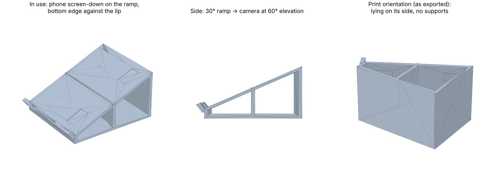

# 60° phone mount



A ramp that holds the phone **screen-down at 30°**, so the back camera points **60° above the horizon**. It exists to make the phone's pose **identical every time**, which is what lets the app's one-time calibration stay valid. Its exact angle doesn't matter, because the calibration absorbs it.

| File | What it is |
|---|---|
| `starlocator_mount_60deg.stl` | Ready to print, already lying on its side in print orientation |
| `starlocator_mount.scad` | Parametric OpenSCAD source: elevation, size, lip, speaker slot, pad recesses |
| `mount_preview.png` | Renders of the part in use, side-on and as printed |

## Dimensions (default parameters)

- Ramp: 30.0° from horizontal (camera elevation 60.0°, checked from the exported mesh's surface normals)
- Footprint: 113 × 100 mm, height 80 mm; the deck is 130 mm along the slope
- Lip: 10 mm tall and square to the deck, with a 40 mm center slot for the bottom speaker and USB port
- Four 24 × 14 × 1 mm recesses for adhesive felt or rubber pads, which protect the screen
- Solid volume about 147 cm³ before infill

Phones longer than 130 mm overhang the top of the ramp. That end holds the camera, which faces up, so nothing touches it.

## Printing

- Print the STL **as exported**: on its side, triangular profile flat on the bed. No supports are needed.
- The geometry has no material-specific features, so any rigid filament works. Stiffer is better (no flex means a repeatable pose).
- Suggested: 4 walls, 20–30% infill, 0.2 mm layers.
- Stick felt or rubber pads into the four recesses.

## Use

1. Put the mount on reasonably level ground. In simulation, tilting the pose by 5° raised the calibrated error from 2–5 km to 5.9 km, and the app's pose indicator warns beyond 3°. The compass direction doesn't matter, so face whichever way the sky is clear.
2. Lay the phone **screen-down** with its **bottom edge against the lip**, camera end up the ramp. Seat it the same way every time, with the same case or none.
3. **Calibrate once** at a known position. The app's live readout then shows "pose OK" while the phone sits in the mount, and warns when the pose is more than 3° off.

## Changing the angle

Edit `camera_elevation` in the `.scad` file and export a new STL with OpenSCAD:

```bash
openscad -o starlocator_mount_60deg.stl starlocator_mount.scad
```

After changing the mount or the angle, calibrate again: the calibration belongs to the pose.
